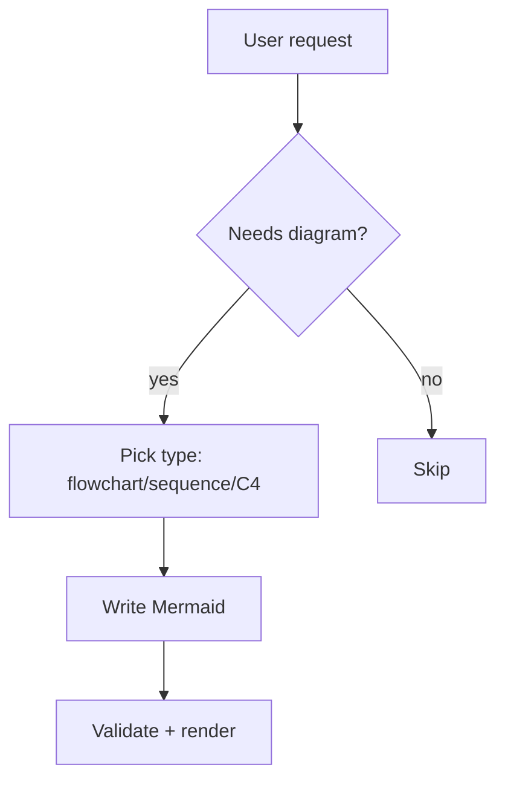
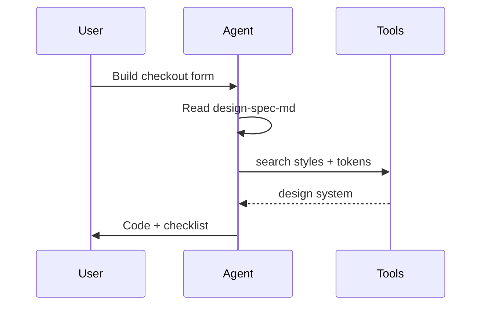
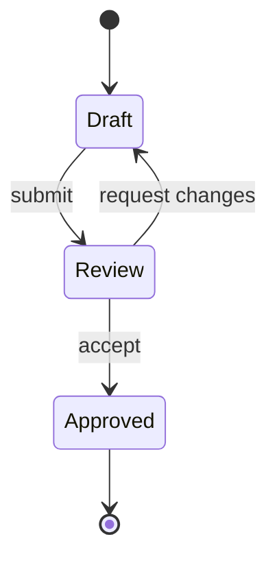
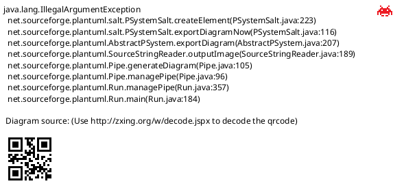
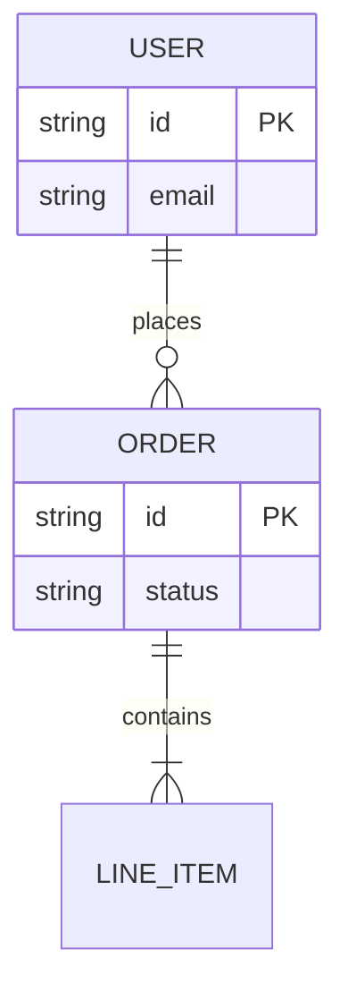

# Diagram as Code

> Workflows, architecture and business processes as validated code, not pixels.

## Quick Start


```bash
# render locally or paste into Mermaid Live
npx @mermaid-js/mermaid-cli -i docs/arch.mmd -o docs/arch.svg
python scripts/validate_mermaid.py docs/arch.mmd
```

## When to Use
- System architecture and service maps
- Business processes and approval flows
- Sequence diagrams for APIs and auth
- State machines, ER diagrams, C4 models
- Docs that must stay in sync with code

## Best Practices

### Picking the Type
- Flowchart: decisions and processes, max 12 nodes per view
- Sequence: interactions over time, name every actor
- Class/ER: data models, no methods except key behavior
- State: explicit initial/final, every transition labeled
- C4: Context for stakeholders, Container for teams, Component for devs

### Readability
- One idea per diagram, split large flows into subgraphs
- Left-to-right for processes, top-to-bottom for hierarchies
- Short node labels (3-5 words), details in notes
- Stable ids in latin, human labels separate

### Correctness
- Every branch has a condition label
- No orphan nodes, no crossing arrows without need
- Actors and services match the real codebase names
- Version the diagram next to the code it describes

### Rendering
- Prefer Mermaid for Markdown-native docs
- C4-PlantUML for enterprise architecture
- SVG output for docs site, dark + light tested
- Keep source `.mmd` in git, render on CI

## Dependencies
```bash
npm i -g @mermaid-js/mermaid-cli
# optional: java + plantuml for C4
java -version
```

## Examples








```markdown
## Decision cheat-sheet
- Process with branches -> flowchart TD/LR
- Two+ actors over time -> sequenceDiagram
- Data tables and keys -> erDiagram
- Lifecycle with transitions -> stateDiagram-v2
- Enterprise landscape -> C4 Context/Container
```

## Step-by-Step
1. State the single question the diagram answers.
2. Pick the minimal type (flowchart, sequence, ER, state, C4).
3. Draft nodes with stable ids and short labels.
4. Label every edge and condition.
5. Validate syntax with the CLI script.
6. Render SVG and check dark/light readability.
7. Split if more than 12 nodes or 3 swimlanes.
8. Commit `.mmd` source next to docs, link from README.

## Validation
1. Mermaid/PlantUML parses with zero errors
2. One question answered, no second story hidden inside
3. All branches labeled, no orphan nodes
4. Names match code and docs terminology
5. Renders cleanly in GitHub, docs site, and print

## Troubleshooting
- Render fails: check unescaped brackets, quotes, and `#` in labels.
- Spaghetti arrows: switch direction TD/LR or split into subgraphs.
- Too dense: extract a subgraph per actor or per phase.
- GitHub shows code not diagram: fence must be `mermaid` language tag exactly.
- C4 too abstract: drop one level (Context -> Container -> Component).
