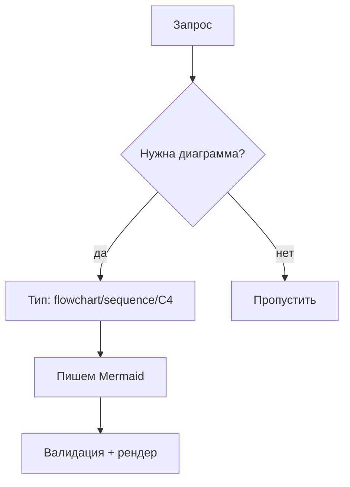
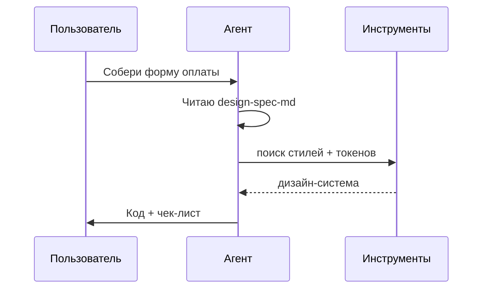
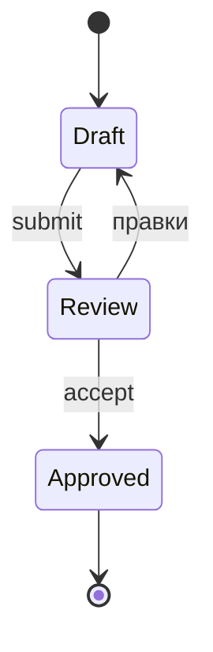
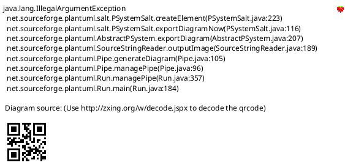
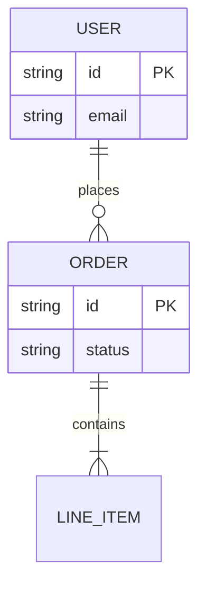

# Диаграммы как код (Diagram as Code)

> Воркфлоу, архитектура и бизнес-процессы как проверяемый код, а не пиксели.

## Быстрый старт


```bash
# рендер локально или вставьте в Mermaid Live
npx @mermaid-js/mermaid-cli -i docs/arch.mmd -o docs/arch.svg
python scripts/validate_mermaid.py docs/arch.mmd
```

## Когда использовать
- Архитектура систем и карта сервисов
- Бизнес-процессы и согласования
- Sequence-диаграммы для API и авторизации
- Машины состояний, ER-диаграммы, C4-модели
- Доки, которые обязаны жить вместе с кодом

## Лучшие практики

### Выбор типа
- Flowchart: решения и процессы, макс 12 узлов на вид
- Sequence: взаимодействия во времени, каждый актор поименован
- Class/ER: модели данных, без лишних методов
- State: явные initial/final, каждый переход подписан
- C4: Context для стейкхолдеров, Container для команд, Component для девов

### Читаемость
- Одна идея на диаграмму, большое режьте на подграфы
- Процессы слева направо, иерархии сверху вниз
- Короткие подписи (3-5 слов), детали в заметках
- Стабильные id латиницей, человеческие подписи отдельно

### Корректность
- У каждой ветки подписано условие
- Без висячих узлов и лишних пересечений стрелок
- Акторы и сервисы совпадают с именами в коде
- Диаграмма версионируется рядом с кодом

### Рендеринг
- Mermaid для Markdown-доков
- C4-PlantUML для enterprise-архитектуры
- SVG для сайта доков, проверяйте dark + light
- Исходник `.mmd` в git, рендер на CI

## Зависимости
```bash
npm i -g @mermaid-js/mermaid-cli
# опционально: java + plantuml для C4
java -version
```

## Примеры








```markdown
## Шпаргалка выбора
- Процесс с ветками -> flowchart TD/LR
- Два+ актора во времени -> sequenceDiagram
- Таблицы и ключи -> erDiagram
- Жизненный цикл -> stateDiagram-v2
- Enterprise-ландшафт -> C4 Context/Container
```

## Пошаговое руководство
1. Сформулируйте один вопрос, на который отвечает диаграмма.
2. Выберите минимальный тип (flowchart, sequence, ER, state, C4).
3. Набросайте узлы со стабильными id и короткими подписями.
4. Подпишите каждое ребро и условие.
5. Проверьте синтаксис CLI-скриптом.
6. Отрендерьте SVG и проверьте читаемость в dark/light.
7. Разбейте, если больше 12 узлов или 3 дорожек.
8. Закоммитьте `.mmd` рядом с доками, ссылку в README.

## Валидация
1. Mermaid/PlantUML парсится без ошибок
2. Отвечен один вопрос, второй истории внутри нет
3. Все ветки подписаны, висячих узлов нет
4. Имена совпадают с кодом и терминологией
5. Чистый рендер в GitHub, на сайте и в печати

## Устранение неполадок
- Рендер падает: проверьте скобки, кавычки и `#` в подписях.
- Спагетти-стрелки: смените направление TD/LR или режьте на подграфы.
- Слишком плотно: вынесите подграф на актора или фазу.
- GitHub показывает код: у забора должен быть языковой тег `mermaid`.
- C4 слишком абстрактна: спуститесь на уровень (Context -> Container -> Component).
